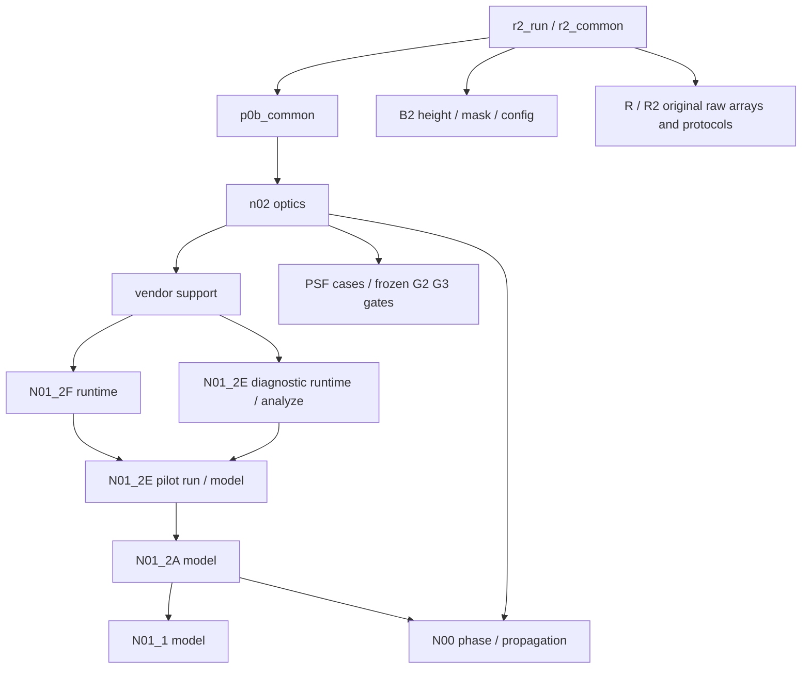

# 真实依赖图与文件闭包

源码逐行AST导入/动态载入/读盘调用共730项，详见dependency_graph_details.json；源绝对路径扫描见absolute_paths_scan.json。R2全部55项输入逐个本地解析并对完整SHA，见R2_input_resolution.json；其9项源码另见R2_source_resolution.json。

DeepLens路径闭包：5_eval_pretrained → hsi_dataset/CaveDataset → cave_val.txt中8场景PNG；HSICamera → diffractive lens与原planar_doe.npy、RGBSensor传感器JSON；NAFNet → nafnet_hsi.pth；6_evaluate_metrics → 新生成的8个spectra.pt → 原src.utils.batch_ssim。完整src保留内部相对import，训练数据未复制。

N00：tests与run_n00_psf → src/spiral_hsi/optics；baseline YAML驱动31波长，正式输出只写新目录。原git HEAD查询改为source_snapshot.json，不依赖旧.git。

B2闭包保留：标准420–660nm每10nm、420–430nm每1nm、546.1nm；所有冻结convergence/cases（包括complex64、cpu_asm、dx05、Fresnel、pad4）；B2高度、mask、冻结hash、各类指标/Gram、根目录协议与门控。未选入B0/B1/B3、制造扰动及大批扫描。R和R2诊断整体保留，历史来源清单可能引用未选入的其他变体，不能据此重跑整包历史审计。

路径分类：历史报告和manifest的旧绝对路径保留原文；活跃N02支持模块和任务书指向新目录。N02原audit.py中的N01追溯数据、个人规划书是历史审计入口限定依赖，未纳入新固定输入验证的运行闭包；若调用该旧audit函数，应预期明确失败，不得调用后声称独立全量重演。N00旧build_report依赖旧双输出布局，未运行；snapshot_reference已显式禁用。

独立性验证：路径屏蔽启用时N00子进程、N02三入口导入、固定数值验证、DeepLens8场景推理和指标均完成。源侧parity为唯一刻意读取旧源码的数值对照，不算独立运行证据。路径屏蔽自测成功拒绝两个源README的读取。

## R06-2当前推理路径补充

5_eval_pretrained读取network.swap_rgb_channels，在相机物理RGB之后、NAFNet之前按[2,1,0]重排；6_evaluate_metrics默认读取results/R06_2_validation并同时记录两种SAM。原R06-2报告、脚本和14项证据原样复制；增量清单见R06_2_update_candidate_dry_run.csv与R06_2_update_copied_sha256.csv。其余光学与数据依赖不变。
